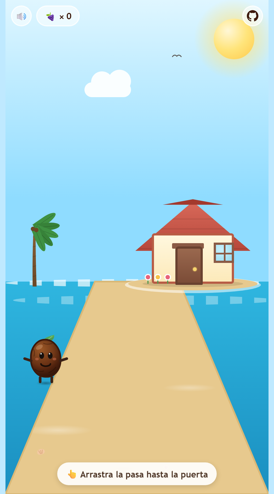

<div align="center">



# 🍇 Pasa Pasa

*Un mini-juego de arrastrar en un solo archivo, sin dependencias y en español*

[](https://github.com/Natanmiuz/olaolapasapasa)

[Características](#características) • [Cómo jugar](#cómo-jugar) • [Ejecutar](#ejecutar) • [Estructura](#estructura) • [Sonido](#sonido) • [Accesibilidad](#accesibilidad) • [Colaborar](#colaborar)

</div>

Una pasa (🍇) llega a la playa buscando refugio y se encuentra con una ola (🌊). Arrastra la pasa hasta la puerta de la casita, charla con la ola y déjala pasar. Cada partida completada suma al contador. Toda la interfaz está en español.

## Características

- **Motor propio en canvas**: un bucle `requestAnimationFrame` con *delta time* dibuja el mundo; el diálogo y los botones siguen siendo HTML.
- **Física de la pasa**: se estira al cogerla, se aplasta y rebota al soltarla, conserva la inercia si la lanzas (¡y cuenta si llega deslizando a la puerta!) y se inclina según la velocidad.
- **Arrastrar y soltar** con ratón o táctil, mediante eventos *pointer* unificados.
- **Control por teclado** con las flechas, para jugar sin ratón.
- **Diálogo en 3 pasos** entre la pasa y la ola. Al final la puerta se abre, la pasa entra en casa y se enciende la luz.
- **Contador de partidas** guardado en `localStorage`: «¡Has dejado pasar a la pasa 7 veces!».
- **Efectos de sonido generados** con la Web Audio API: sin archivos de audio ni licencias que gestionar.
- **Escena animada**: sol, pájaros, nubes, palmera, espuma de mar y conchas.
- **Respeto por `prefers-reduced-motion`** para quien prefiera menos animación.

> [!NOTE]
> El juego está pensado para móvil (táctil) y escritorio (ratón y teclado).

## Cómo jugar

1. Abre `index.html` en cualquier navegador.
2. Arrastra (o lanza) la pasa hasta la puerta de la casa — en escritorio también puedes moverla con las flechas del teclado.
3. Pulsa **Siguiente** para avanzar el diálogo con la ola.
4. Pulsa **¡Entrar!**: la pasa entra en casa, el contador sube y te esperan confeti y un jingle de victoria. 🎉
5. **Jugar otra vez** reinicia la partida sin recargar la página.

## Ejecutar

No hay build, ni instalación, ni servidor:

```bash
# Basta con abrir el archivo directamente en el navegador
open index.html    # macOS
start index.html   # Windows
```

## Estructura

Todo el juego vive en un único archivo autocontenido:

```
index.html   # Markup + CSS + JavaScript en línea
docs/screenshot.png
```

- **Canvas 2D** para el mundo: escenario, pasa, ola y confeti se dibujan con *paths*, sin imágenes.
- **HTML + CSS** para la interfaz (diálogo, botones, contador), con variables personalizadas en `:root` que también usa el canvas.
- **JavaScript** en una IIFE con `'use strict'`, sin dependencias ni variables globales: bucle `update(dt)` → `render()`, muelles (`spring`) para la física y *tweens* con promesas para la secuencia final.
- **Sonido** mediante `tone()`, `sweep()` y helpers de SFX (`sfxPickUp`, `sfxDrop`, `sfxArrive`, `sfxDoorOpen`, `sfxVictory`…) sobre la Web Audio API.

## Sonido

Los efectos se sintetizan en tiempo real con la Web Audio API, por lo que no hay archivos de audio externos. Pulsa el botón **🔊** (arriba a la izquierda) para silenciar o reactivar el sonido.

## Accesibilidad

- Se puede jugar solo con teclado: el canvas recibe el foco (con un anillo visible alrededor de la pasa) y las flechas la mueven; manteniéndolas pulsadas, camina.
- Con `prefers-reduced-motion` se desactivan las animaciones CSS y, en el canvas, se congelan las animaciones ambientales, la física deja de rebotar y no hay confeti.
- El diálogo y el resultado final se anuncian con `aria-live`, y los elementos interactivos tienen etiquetas accesibles.

## Colaborar

¿Ideas para mejorar el juego? Las pull requests son bienvenidas.

> [!IMPORTANT]
> Se aceptan mejoras con tal de trollear al pelucas del ADRITY. 😎